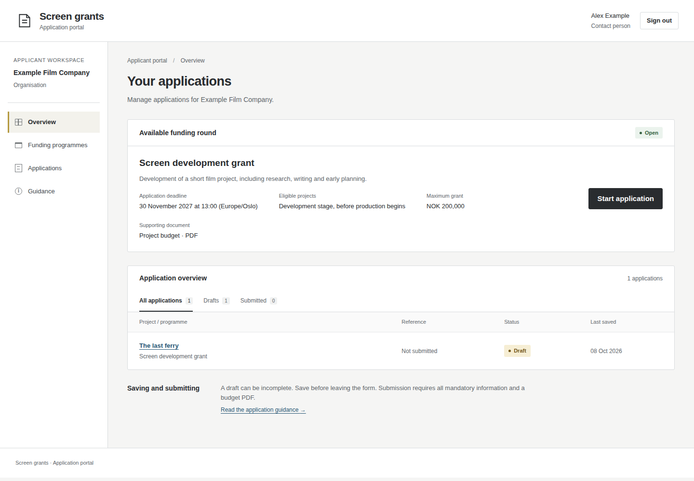
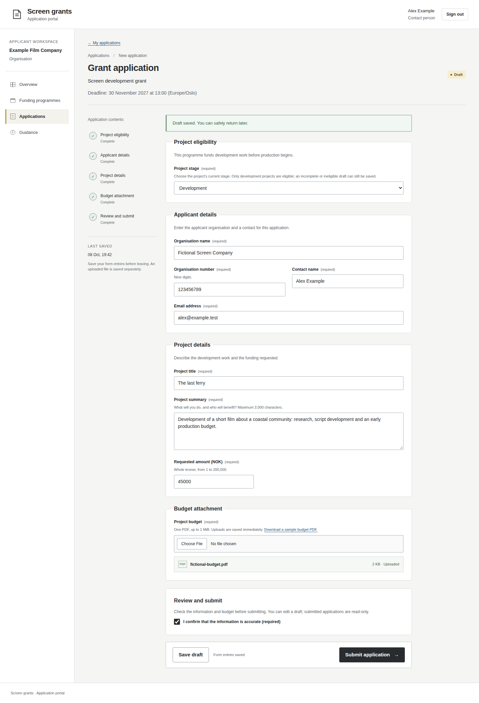
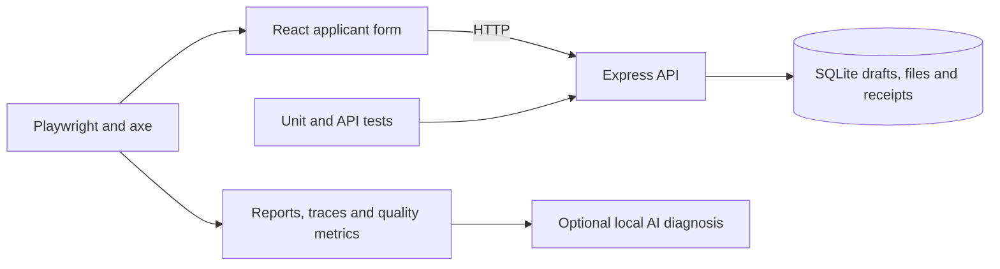

# Søknadslab

[](https://github.com/alexpalexpinne/soknadslab/actions/workflows/quality.yml)

How I would approach quality engineering for a grant application platform. I built a small, realistic grant application service and a risk-based test suite around it: Playwright end-to-end tests, real API and database tests, automated accessibility checks, CI quality gates and AI-assisted test analysis.

## Summary

- **Risk-based test strategy:** [eleven applicant risks](docs/TEST_STRATEGY.md), each mapped to the cheapest test level that can prove it is handled. Ten are automated here; the load peak before a deadline is planned as separate performance work.
- **47 unit and API tests** against the real Express server and SQLite database: rule boundaries, deadlines, submitted-state integrity, and a multi-process test where separate processes submit the same application at the same instant.
- **16 Playwright scenarios** focused on what goes wrong for an applicant: double submission, the deadline passing while a form is open, a lost response after submit, a stale tab overwriting newer work.
- **Accessibility:** axe (WCAG 2.2 A/AA) across eight states, plus a keyboard-only error-recovery test.
- **CI/CD:** [GitHub Actions](.github/workflows/quality.yml) runs a fast gate and Chromium smoke tests on pull requests, and the full Chromium / Firefox / WebKit matrix on main. A flaky pass fails the gate.
- **AI with a human review step:** [how I used AI to generate test scenarios, and a local-model setup for suggesting causes of failed tests](docs/AI_IN_TESTING.md) that keeps test evidence on the machine. The evidence filter and model call are unit-tested against a stand-in; the setup has not yet been run against a real model.

Where to start reading: [the applicant journey](tests/application/application.spec.ts), [the reliability tests](tests/reliability/reliability.spec.ts) and [the server integrity tests](tests/fast/api.test.ts). In every scenario, the important assertion is the stored business outcome, not just a clicked button.



The service has programme discovery, an application list with draft/submitted filters, and a form with section navigation. The fictional Screen development grant places it in the film-funding domain.



## What the tests prove

| Business promise                            | Evidence                                                                                                     |
| ------------------------------------------- | ------------------------------------------------------------------------------------------------------------ |
| Applicant work survives a saved draft       | Save/reopen/reload E2E; SQLite persistence integration test                                                  |
| Incomplete applications are not accepted    | Unit boundaries, server validation and focused UI error test                                                 |
| Ineligible projects remain drafts           | Stage decision table, independent API guard and save/reopen/error-recovery E2E                               |
| Deadline decisions preserve work and trust  | Exact API cutoff tests; real backend clock advanced during an open browser form; receipt retry after closing |
| Submission happens once                     | Atomic transition; simultaneous submits from separate processes; double-click and retry test                 |
| Submitted data stays unchanged              | Server save/upload guards, stale-tab conflict, read-only / Back test                                         |
| Failures are understandable and recoverable | Save/upload faults preserve data; lost submit response reconciles to stored receipt                          |
| Critical workflows remain accessible        | Axe across eight states plus keyboard error recovery                                                         |

The tests also earned their place during the build: they caught real accessibility defects and a concurrency bug, which I fixed in the application ([validation record](docs/VALIDATION.md)).

## Design decisions that make quality testable



- **The server owns the rules.** Validation, eligibility, deadlines and status changes are enforced by the API. A read-only form in the browser proves nothing if the API still accepts changes.
- **Drafts are permissive, submission is strict.** An applicant can always save work, but invalid or ineligible applications are never accepted.
- **Explicit save, no autosave.** Clear promises are easier to test and easier for applicants to trust.
- **Versioned drafts.** Every save carries a revision, so a stale tab gets a conflict instead of silently overwriting newer work.
- **Submission is atomic and idempotent.** Fields, status and receipt change in one transaction; repeating a submit returns the original receipt.
- **Time is injectable.** The deadline (13:00 Europe/Oslo) is checked against the server's clock, and tests control that clock directly, without a test-only API endpoint.

TypeScript, React and Vite; Express with Node's built-in SQLite. One process, no cloud services or database containers.

## If this were a multi-customer platform

This demo has one funder, one programme and one form. A real grant platform serves many funders, each configuring its own schemes, forms, deadlines and applicant rules, and a single platform release can affect all of them. My approach would be:

- **Test the shared form engine once, thoroughly.** Saving, validation, deadlines, submission and recovery are platform behaviour and belong in the platform's own unit, API and E2E suites, not repeated per customer.
- **Drive tests from configuration.** Run the same checks over each customer's form configuration: it loads, required fields are enforced, deadlines are respected and axe finds no violations.
- **Keep a representative set as smoke tests.** A handful of real-world configurations run on every pull request; the full configuration set runs nightly.
- **Own customer-specific rules in customer projects.** New schemes and special rules get their tests as part of the customer delivery, using the same standards and fixtures.
- **Keep feedback fast as the suite grows.** Tags, sharding and parallel workers, with flaky-test rate and suite duration tracked as quality metrics.

## Run it

Requires **Node.js 24**. No external accounts, credentials or services.

```bash
git clone https://github.com/alexpalexpinne/soknadslab.git
cd soknadslab
npm ci
npm run dev
```

Open **http://127.0.0.1:5173**, sign in to the fake account, choose the programme, select **Development** as the project stage, fill in the details, attach the downloadable fictional budget PDF, save, then submit and view the read-only receipt. Each sign-in gets an isolated workspace; signing out removes it.

The fictional round closes **30 November 2027 at 13:00 Europe/Oslo** (configured in `src/domain.ts`). Existing drafts can still be saved after the deadline but not submitted.

`npm run dev:lan` serves the demo on all IPv4 interfaces so it can be opened from another device on the local network.

## Run the quality checks

```bash
npx playwright install --with-deps chromium  # once
npm run check                                # lint, types, unit/API tests, build
npm run test:smoke                           # critical Chromium + accessibility
npm run test:e2e                             # all 16 Chromium scenarios
npm run report                               # HTML report

# Full browser matrix
npx playwright install --with-deps firefox webkit
npm run test:browsers
```

Playwright starts its own build on port 4173 with disposable storage and a fixed open-round clock. Every test signs into a fresh workspace with deterministic fictional data and uses accessible locators. Browser requests are restricted to the local test server.

## Gates and evidence

Pull requests run lint, types, unit/API tests, the build and Chromium smoke/accessibility tests. Each run publishes a quality summary (pass rate, flaky rate, duration, failing cases) on the GitHub Actions run page. Main, weekly and manual runs execute the full three-browser matrix. One retry is allowed for diagnosis, but a test that only passes on retry still fails the gate. Reports, traces, screenshots, videos and axe results are kept as build artifacts for seven days.

A custom reporter writes `reports/quality.json` with run duration, first-attempt pass rate and flaky outcomes. Axe covers WCAG A/AA rules through 2.2; screen-reader, zoom and user testing remain manual work.

## Scope

Real identity and roles, the case-handling side, notifications, malware scanning and production hosting are outside this demo. It is a small test target built to show quality decisions, not a production grant platform.
